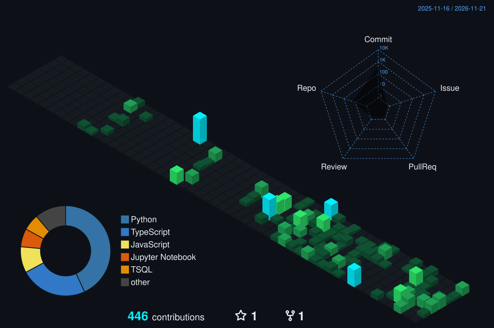
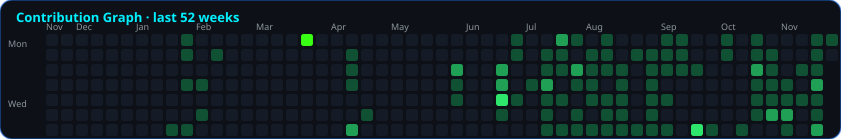
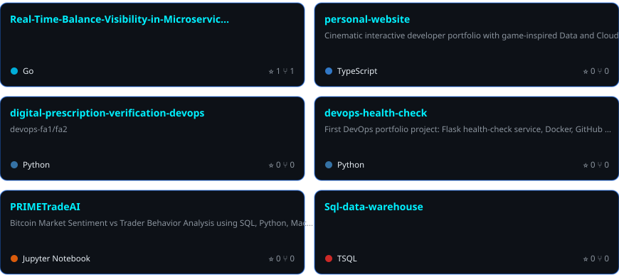

<!-- GitHub Profile README — dark futuristic dashboard, fully self-hosted assets.
     All statistics are generated from the live GitHub API by .github/workflows/profile-graphics.yml
     (see scripts/update_stats.py). No numbers are hardcoded. -->

  

---

<h2 align="center">📊 GitHub Statistics</h2>

  

<table align="center">
  <tr>
    <td align="center"></td>
    <td align="center"></td>
  </tr>
</table>

---

<h2 align="center">📈 Contribution Graph</h2>

  

  

  

---

<h2 align="center">📌 Featured Repositories</h2>

  

  👉 <a href="https://github.com/yashmahajan11234567?tab=repositories">View all repositories</a>

---

<h2 align="center">🛠️ Skills &amp; Technologies</h2>

<table align="center">
  <tr>
    <td align="center"></td>
    <td align="center"></td>
    <td align="center"></td>
    <td align="center"></td>
    <td align="center"></td>
    <td align="center"></td>
    <td align="center"></td>
    <td align="center"></td>
  </tr>
  <tr>
    <td align="center"></td>
    <td align="center"></td>
    <td align="center"></td>
    <td align="center"></td>
    <td align="center"></td>
    <td align="center"></td>
    <td align="center"></td>
    <td align="center"></td>
  </tr>
  <tr>
    <td align="center"></td>
    <td align="center"></td>
    <td align="center"></td>
    <td align="center"></td>
    <td align="center"></td>
    <td align="center"></td>
    <td align="center"></td>
    <td align="center"></td>
  </tr>
</table>

---

<h2 align="center">🤝 Connect</h2>

  🌐 <a href="https://personal-website-river.vercel.app"><b>Portfolio</b></a> &nbsp;·&nbsp;
  🐙 <a href="https://github.com/yashmahajan11234567"><b>GitHub</b></a> &nbsp;·&nbsp;
  📍 Pune, India

  Profile graphics regenerate daily via GitHub Actions — no paid services, all data from the live GitHub API.

