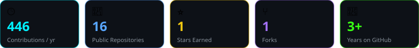
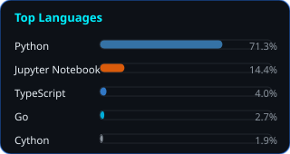
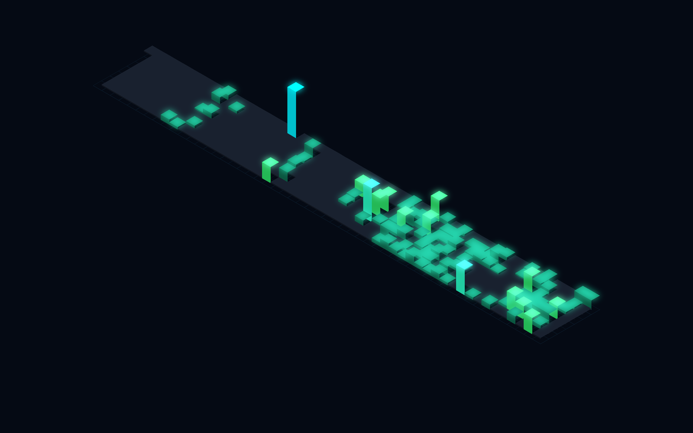

<!-- GitHub Profile README — dark futuristic dashboard, fully self-hosted assets.
     All statistics are generated from the live GitHub API by .github/workflows/profile-graphics.yml
     (see scripts/update_stats.py). No numbers are hardcoded. -->

  

<h3>About Me</h3>

Computer Engineering student focused on building data-driven solutions through analytics, data engineering and cloud technologies. Interested in scalable infrastructure, automation and intelligent systems.

<table align="center">
  <tr>
    <td align="center"><a href="https://personal-website-k4x.pages.dev/"> Portfolio · Cloudflare Pages</a></td>
    <td align="center"></td>
    <td align="center"><a href="https://github.com/yashmahajan11234567"> GitHub</a></td>
    <td align="center"></td>
    <td align="center"> Pune, India</td>
  </tr>
</table>

---

<h2 align="center"> GitHub Statistics</h2>

  <picture>
    <source media="(max-width: 640px)" srcset="assets/stats-mobile.svg"/>
    
  </picture>

<table align="center">
  <tr>
    <td align="center"></td>
    <td align="center"></td>
  </tr>
</table>

---

<h2 align="center"> 3D Contribution Graph</h2>

  

  One year of contributions as glowing 3D blocks — drag to rotate, hover for the day's count in the interactive version.

  

---

<h2 align="center">Featured Projects</h2>

<table align="center">
  <tr>
    <td width="50%" style="background:#0d1420;border:1px solid #1f3a5f;border-radius:10px;padding:14px 16px;vertical-align:top">
      <a href="https://github.com/yashmahajan11234567/Bluestock-fintech" style="color:#22d5ff"><strong>Bluestock Fintech</strong></a> · data 
      Integrated financial analytics platform featuring Nifty 100 stock analysis and Mutual Fund Analysis, with interactive dashboards, financial metrics, screening, peer comparison, sector analysis, and reporting. 
      Python · Pandas · SQL · Streamlit · Plotly · Financial Analytics 
    </td>
    <td width="50%" style="background:#0d1420;border:1px solid #1f3a5f;border-radius:10px;padding:14px 16px;vertical-align:top">
      <a href="https://github.com/yashmahajan11234567/digital-prescription-verification-devops" style="color:#22d5ff"><strong>RxVerify — Digital Prescription Verification</strong></a> · cloud 
      Prescription verification system productionized: Docker/Compose, Minikube with probes and rollback, GitHub Actions to GHCR, Prometheus/Grafana/Loki, Terraform + Ansible on AWS. 
      Kubernetes · Minikube · Docker · GitHub Actions · Prometheus · Grafana · Loki · Terraform · AWS · Ansible · Flask · pytest · Playwright 
    </td>
  </tr>
  <tr>
    <td style="background:#0d1420;border:1px solid #1f3a5f;border-radius:10px;padding:14px 16px;vertical-align:top">
      <a href="https://github.com/yashmahajan11234567/Sql-data-warehouse" style="color:#22d5ff"><strong>SQL Data Warehouse &amp; ETL</strong></a> · data 
      Medallion architecture in T-SQL on SQL Server: bronze BULK INSERT loads, windowed silver transforms, gold star schema, per-layer quality assertions. 
      T-SQL · SQL Server · BULK INSERT · Window Functions · Star Schema 
    </td>
    <td style="background:#0d1420;border:1px solid #1f3a5f;border-radius:10px;padding:14px 16px;vertical-align:top">
      <a href="https://github.com/yashmahajan11234567/Full-Stack-AI-DevOps-Masterclass" style="color:#22d5ff"><strong>Full-Stack AI DevOps Masterclass</strong></a> · cloud 
      College open-elective coursework: Node.js, Python and Spring Boot apps containerized with Docker, wired through GitHub Actions and Kubernetes. 
      Docker · Docker Compose · GitHub Actions · Kubernetes · Node.js · Python · Java 
    </td>
  </tr>
  <tr>
    <td style="background:#0d1420;border:1px solid #1f3a5f;border-radius:10px;padding:14px 16px;vertical-align:top">
      <a href="https://github.com/yashmahajan11234567/PRIMETradeAI" style="color:#22d5ff"><strong>PRIMETradeAI</strong></a> · data 
      Bitcoin Fear &amp; Greed sentiment vs Hyperliquid trader profitability: nine T-SQL analytical queries, RandomForest + KMeans, Streamlit dashboard. 
      T-SQL · Python · pandas · scikit-learn · Streamlit 
    </td>
    <td style="background:#0d1420;border:1px solid #1f3a5f;border-radius:10px;padding:14px 16px;vertical-align:top">
      <a href="https://github.com/yashmahajan11234567/Real-Time-Balance-Visibility-in-Microservice-Based-Money-Transfers" style="color:#22d5ff"><strong>Go Microservices — Real-Time Balance Visibility</strong></a> · cloud 
      Go microservices with hexagonal layering and a double-entry ledger; pinned CI with SBOM, Prometheus/OpenTelemetry, Toxiproxy fault injection. 
      Go · PostgreSQL · Docker · GitHub Actions · Prometheus · OpenTelemetry 
    </td>
  </tr>
  <tr>
    <td style="background:#0d1420;border:1px solid #1f3a5f;border-radius:10px;padding:14px 16px;vertical-align:top">
      <a href="https://github.com/yashmahajan11234567/Projects/tree/main/Data-Analytics-Projects" style="color:#22d5ff"><strong>Data Analytics Dashboards</strong></a> · data 
      Five interactive dashboards in one repository, each with its committed source file and preview: Bike Sales (Excel), COVID-19 and HR (Tableau), Netflix (Tableau + Power BI). 
      Excel · Tableau · Power BI 
    </td>
    <td></td>
  </tr>
</table>

  <a href="https://github.com/yashmahajan11234567?tab=repositories">View all repositories</a>

---

<h2 align="center">Skills &amp; Technologies</h2>

<table align="center">
  <tr>
    <td align="center"></td>
    <td align="center"></td>
    <td align="center"></td>
    <td align="center"></td>
    <td align="center"></td>
    <td align="center"></td>
    <td align="center"></td>
    <td align="center"></td>
  </tr>
  <tr>
    <td align="center"></td>
    <td align="center"></td>
    <td align="center"></td>
    <td align="center"></td>
    <td align="center"></td>
    <td align="center"></td>
    <td align="center"></td>
    <td align="center"></td>
  </tr>
  <tr>
    <td align="center"></td>
    <td align="center"></td>
    <td align="center"></td>
    <td align="center"></td>
    <td align="center"></td>
    <td align="center"></td>
    <td align="center"></td>
    <td align="center"></td>
  </tr>
</table>

---

<h2 align="center">Connect</h2>

  <a href="https://personal-website-k4x.pages.dev/">Portfolio · Cloudflare Pages</a> &nbsp;·&nbsp;
  <a href="https://github.com/yashmahajan11234567">GitHub</a> &nbsp;·&nbsp;
  Pune, India

  Profile graphics regenerate daily via GitHub Actions — no paid services, all data from the live GitHub API.

